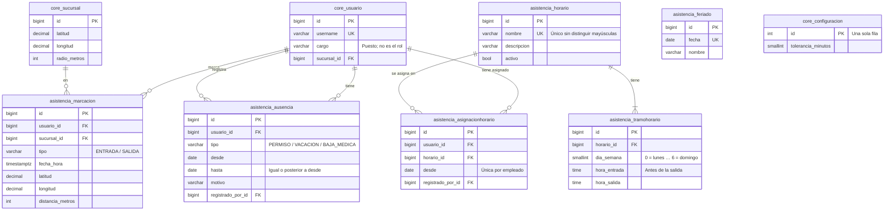

# Control de asistencia

Ópticas Casimiro · SIS301 Análisis y Diseño de Sistemas

Este documento acompaña al módulo de asistencia (app `asistencia`). Reúne la guía de demostración, el diagrama entidad-relación, los permisos, las reglas de cálculo y la correspondencia con los requisitos del documento de visión.

**Estado:** cubre RF15 (marcación por geolocalización), RF17 (horarios con varios tramos por día), RF18 (tolerancia configurable), RF19 (cálculo de atrasos, faltas y horas), RF20 (reportes), RF26 (cargo y sucursal del empleado), RF27 (permisos y vacaciones) y RF28 (feriados).

## 1. Cómo ejecutar la demostración

```bash
.venv/Scripts/python manage.py migrate
.venv/Scripts/python manage.py preparar_demo
.venv/Scripts/python manage.py runserver
```

`preparar_demo` carga:

- **Horarios:** un *Horario partido* (lunes a viernes de 08:30 a 12:30 y de 14:30 a 19:30; sábado de 09:00 a 13:00) y un *Medio tiempo (mañana)*.
- **Asignaciones:** todo el personal tiene el horario partido desde hace 30 días, salvo `empleado2`, que tiene medio tiempo.
- **Feriados:** los nacionales de 2026 y el aniversario de Chuquisaca.
- **Permisos y vacaciones:** una vacación de tres días de `empleado2` y un permiso de un día de `cajero1`.
- **Marcaciones:** dos semanas para todo el personal, con estos casos:
  - `empleado1`: un atraso de 22 minutos, un día en que no volvió en la tarde (tramo sin marcar) y una falta;
  - `cajero1`: un atraso de 11 minutos (supera la tolerancia de 10) y una entrada 4 minutos tarde (dentro de la tolerancia).

Todos los usuarios tienen la contraseña **`Casimiro2026!`**.

| Usuario | Qué demostrar |
|---|---|
| `rrhh` | Horarios, asignación por fecha, cargo, permisos y vacaciones, feriados, tolerancia y reportes |
| `gerente` | Reportes de asistencia y tolerancia (no gestiona horarios ni permisos) |
| `empleado1` | Marca su asistencia, ve su horario del día y consulta *Mi asistencia* |

**Recorrido sugerido:**

1. Como `rrhh`, abra *Asistencia → Reporte de asistencia*. El período por defecto es el mes en curso; elija las dos últimas semanas. Cada fila muestra los días laborables, asistidos, faltas, atrasos (con minutos), tramos sin marcar, permisos y horas trabajadas.
2. Entre a `empleado1` (Luis Fernández): el detalle día por día muestra el atraso, el tramo de la tarde «sin marcar», la falta, el feriado de Todos Santos y los domingos de descanso.
3. En *Administración → Parámetros*, cambie la tolerancia a 25 minutos y vuelva al reporte: el atraso de 22 minutos deja de contarse. El cálculo no guarda nada, así que se recalcula al instante.
4. En *Asistencia → Permisos y vacaciones*, registre un permiso para `empleado1` el día de su falta: en el reporte, ese día pasa a «Permiso» y la falta desaparece. Si se cruza con otro permiso, el sistema lo rechaza.
5. En *Asistencia → Personal y horarios → Horarios*, cree un horario nuevo (el botón *Copiar el lunes de martes a viernes* ayuda) y asígnelo a un empleado desde mañana en su ficha: los días anteriores siguen calculándose con el horario anterior.
6. Como `empleado1`, abra *Asistencia → Marcar entrada/salida*: la pantalla muestra su horario de hoy, o que es feriado. *Mi asistencia* muestra su propio detalle, y no puede ver el de otros.

## 2. Diagrama entidad-relación



`core_usuario`, `core_sucursal` y `core_configuracion` se muestran solo con los campos que intervienen aquí; el detalle está en [`gestion_usuarios.md`](gestion_usuarios.md#2-diagrama-entidad-relación). `asistencia_feriado` no tiene relaciones: vale para todas las sucursales.

**Notas de diseño:**

- **Horario con tramos:** un horario tiene tramos por día de la semana; un día con dos tramos es un horario partido. La pantalla admite dos tramos por día; el modelo admite más.
- **Asignación por fecha:** el horario de un empleado en una fecha es el de su asignación más reciente con `desde` menor o igual a esa fecha. Cambiar de horario no reescribe el pasado.
- **Cálculo sin tablas intermedias:** atrasos, faltas y horas no se guardan; se calculan al consultar (`asistencia/calculo.py`). Así, un permiso registrado después, un feriado agregado o un cambio de tolerancia se reflejan de inmediato en los reportes.
- **Integridad referencial:** las asignaciones, ausencias y marcaciones apuntan al usuario con `PROTECT`. Un horario asignado no se puede borrar; se desactiva. Los tramos se borran con su horario (`CASCADE`).

## 3. Permisos

Extracto de la matriz que genera `manage.py matriz_permisos`. La matriz completa está en [`gestion_usuarios.md`](gestion_usuarios.md#3-matriz-de-permisos-por-rol).

| Módulo | Permiso | Código | Administrador | Gerente | Cajero/Vendedor | Recursos Humanos | Encargado de almacén | Óptico/Técnico de taller | Empleado |
|---|---|---|:---:|:---:|:---:|:---:|:---:|:---:|:---:|
| Parámetros | Definir la tolerancia de atraso | `core.configurar_asistencia` | ✔ | ✔ |  | ✔ |  |  |  |
| Asistencia | Marcar su entrada/salida y ver su historial | `asistencia.marcar_asistencia` | ✔ | ✔ | ✔ | ✔ | ✔ | ✔ | ✔ |
| Asistencia | Ver la asistencia y los reportes de todo el personal | `asistencia.ver_todas_marcaciones` | ✔ | ✔ |  | ✔ |  |  |  |
| Asistencia | Gestionar horarios, asignarlos y editar el cargo del personal | `asistencia.gestionar_horarios` | ✔ |  |  | ✔ |  |  |  |
| Asistencia | Registrar permisos y vacaciones del personal | `asistencia.gestionar_ausencias` | ✔ |  |  | ✔ |  |  |  |
| Asistencia | Gestionar el calendario de feriados | `asistencia.gestionar_feriados` | ✔ |  |  | ✔ |  |  |  |

- La pantalla de *Parámetros* muestra a cada uno solo las secciones de su permiso: RR.HH. cambia la tolerancia, pero no el anticipo mínimo de las ventas.
- Quien marca asistencia consulta su propio detalle en *Mi asistencia*, sin ver el de otros.
- Los datos personales, el rol y la sucursal siguen editándose en *Administración → Usuarios*; RR.HH. edita el cargo y el horario.

## 4. Reglas de cálculo (RF19)

- **Entrada de cada tramo:** es la primera marcación de entrada desde la mitad del descanso anterior (o desde el inicio del día, para el primer tramo) hasta el fin del tramo. Así, una entrada a las 14:20 cuenta para el tramo de la tarde (14:30) y no para el de la mañana.
- **Atraso:** si la entrada llega después de la hora del tramo más la tolerancia, el atraso se cuenta desde la hora del tramo. Con 10 minutos de tolerancia, entrar a las 08:38 es puntual y entrar a las 08:45 son 15 minutos de atraso.
- **Falta:** un día laborable (con tramos en el horario, sin feriado ni permiso) sin ninguna entrada. El día de hoy solo es falta cuando terminaron todos sus tramos; antes aparece «en curso».
- **Tramo sin marcar:** si se marca un tramo pero no otro (por ejemplo, no vuelve en la tarde), el día cuenta como asistido y el tramo se informa aparte.
- **Horas trabajadas:** la suma de cada entrada con su salida, también en días sin horario (por ejemplo, un domingo trabajado). Una entrada sin salida en un día pasado no suma horas y se marca «salida sin marcar».
- **Permisos, vacaciones, bajas médicas y feriados:** cubren días completos. Esos días no cuentan como falta ni atraso. Dos permisos del mismo empleado no pueden cruzarse.

## 5. Cumplimiento de los requisitos

| Requisito | Implementación |
|---|---|
| RF15 Marcación con geolocalización | Se acepta solo dentro del radio de la sucursal. Ahora la pantalla también muestra el horario del día |
| RF17 Horarios con varios tramos por día | *Personal y horarios → Horarios*: grilla de lunes a domingo con dos tramos por día, y asignación por fecha en la ficha del empleado |
| RF18 Tolerancia y parámetros | *Administración → Parámetros → Asistencia*: tolerancia en minutos (10 al iniciar) |
| RF19 Cálculo de atrasos, faltas y horas | `asistencia/calculo.py`, por tramo, descontando permisos, vacaciones y feriados |
| RF20 Reportes por empleado, sucursal y período | *Reporte de asistencia* con filtro de período y sucursal, detalle por empleado día por día, exportación a CSV e impresión |
| RF26 Datos de los empleados | Datos personales y sucursal en *Usuarios*; cargo y horario en *Personal y horarios* |
| RF27 Permisos y vacaciones | *Permisos y vacaciones*: permiso, vacación o baja médica por días completos, sin cruces |
| RF28 Calendario de feriados | *Feriados*, por año, con fecha única |

## 6. Pruebas

```bash
.venv/Scripts/python manage.py test asistencia
```

`asistencia/tests_calculo.py` cubre:

- el cálculo: atraso con y sin tolerancia, horas trabajadas, una semana completa con falta, tramo sin marcar, feriado y vacación, el día de hoy «en curso», la salida sin marcar, las horas fuera de horario y la vigencia de las asignaciones;
- las validaciones de la grilla de horarios y el reemplazo de tramos al editar;
- los permisos que se cruzan;
- los feriados duplicados;
- la ficha del empleado;
- los reportes y su CSV;
- los permisos de cada pantalla y los parámetros por sección.

`asistencia/tests.py` cubre la marcación por geolocalización.
