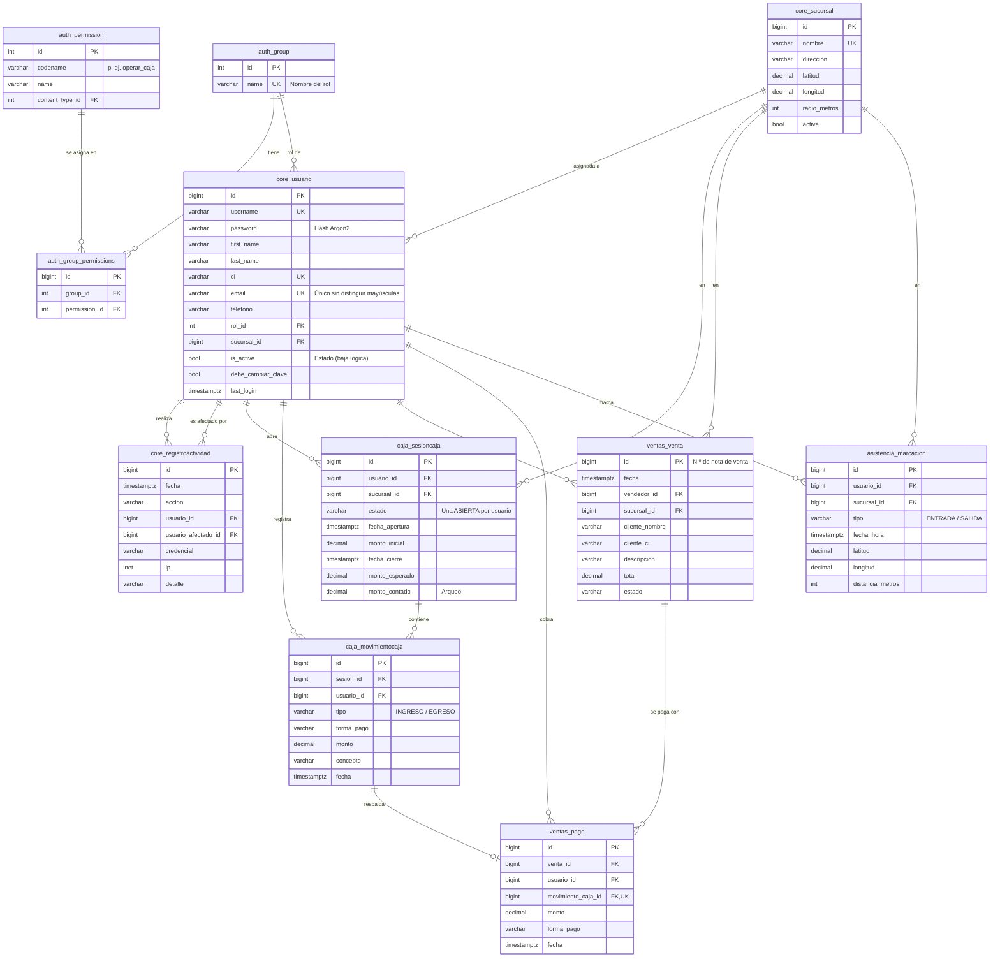

# Módulo de Gestión de Usuarios · Segunda entrega

Ópticas Casimiro · SIS301 Análisis y Diseño de Sistemas

Este documento acompaña al código fuente del módulo. Reúne el diagrama entidad-relación, la matriz de permisos por rol, la correspondencia con los requisitos del enunciado y la guía de demostración.

## 1. Cómo ejecutar la demostración

```bash
.venv/Scripts/python manage.py migrate
.venv/Scripts/python manage.py preparar_demo      # deja la base en el estado inicial de la demostración
.venv/Scripts/python manage.py runserver
```

`preparar_demo` borra las ventas, cajas, marcaciones, la auditoría, las sesiones abiertas y los usuarios creados durante los ensayos. Después recarga los usuarios de prueba con su contraseña original y una caja cerrada de ejemplo, con una venta que tiene saldo pendiente. Los superusuarios se conservan. Ejecútelo antes de cada ensayo y antes de presentar. Solo funciona con `DJANGO_DEBUG=True`, y pide confirmación salvo que se use `--si`.

El sistema no necesita internet: Bootstrap, los íconos, HTMX y la tipografía están dentro del proyecto (`static/vendor/`).

Abra http://127.0.0.1:8000/ e inicie sesión con cualquiera de estos usuarios. Todos tienen la contraseña **`Casimiro2026!`**; también puede ingresar con el correo, por ejemplo `cajero1@opticascasimiro.test`.

| Usuario | Rol | Sucursal | Qué demostrar |
|---|---|---|---|
| `administrador` | Administrador | Centro | CRUD de usuarios, sucursales, registro de actividad y todos los módulos |
| `gerente` | Gerente | Centro | Ve ventas, cajas y asistencia de todos; no puede crear ni editar usuarios |
| `cajero1` | Cajero/Vendedor | Centro | Abre caja, registra ventas y pagos, cierra con arqueo. Tiene una caja cerrada de ejemplo |
| `cajero2` | Cajero/Vendedor | Norte | No ve las ventas ni las cajas de `cajero1` |
| `rrhh` | Recursos Humanos | Centro | Ve la asistencia de todo el personal |
| `empleado1` | Empleado | Centro | Solo marca su asistencia y ve su historial. Tiene marcaciones de ayer |
| `almacen`, `optico`, `empleado2` | Otros roles | — | Mismo acceso que Empleado por ahora |
| `exempleado` | Empleado | Centro | **Cuenta desactivada**: el inicio de sesión se rechaza |

Las capturas de cada paso están en [`capturas/`](capturas/).

**Recorrido sugerido:**

1. Inicie sesión como `empleado1` y compruebe que el menú solo muestra *Asistencia*. Si intenta entrar a `/administracion/usuarios/`, obtiene *Acceso denegado*.
2. Inicie sesión como `cajero1`: abra la caja, registre una venta con un anticipo, imprima la nota de venta (lleva el vendedor en el encabezado), cobre el saldo y cierre la caja con el arqueo.
3. Inicie sesión como `administrador`:
   - cree un usuario;
   - búsquelo por nombre o CI;
   - cámbiele el rol;
   - resetee su contraseña;
   - desactívelo.
4. Revise *Administración → Registro de actividad*: aparecen los inicios de sesión, los intentos fallidos, los cambios de contraseña y la creación y desactivación de cuentas.
5. Inicie sesión con el usuario creado en el paso 3. El sistema obliga a cambiar la contraseña inicial antes de continuar.

**Marcación de asistencia desde la laptop:** la marcación solo se acepta dentro del radio de la sucursal (150 m en los datos de prueba). Para demostrarla sin estar en la sucursal, simule la ubicación en Chrome o Edge:

1. Inicie sesión como `empleado1` y abra *Asistencia → Marcar entrada/salida*.
2. Abra las herramientas de desarrollo (F12) y luego ⋮ → *More tools* → *Sensors*.
3. En *Location*, elija *Other…* e ingrese las coordenadas de la Sucursal Centro: latitud `-19.0475`, longitud `-65.2593`.
4. Pulse *Marcar entrada*. Cuando el navegador lo pida, permita el acceso a la ubicación.
5. Para mostrar el rechazo, cambie la latitud a `-19.0600` (unos 1,4 km) y vuelva a marcar. El sistema responde que está fuera del radio permitido.

La geolocalización solo funciona en `localhost` o con HTTPS, así que abra el sistema en `http://127.0.0.1:8000` o `http://localhost:8000`, no con la IP de la red.

## 2. Diagrama entidad-relación



Para exportarlo como imagen, pegue el bloque en https://mermaid.live y descárguelo en PNG o SVG.

**Notas de diseño:**

- **Roles y permisos:** se usan las tablas de Django `auth_group` (roles), `auth_permission` (permisos) y `auth_group_permissions` (matriz rol-permiso).
- **Rol del usuario:** cada usuario tiene un solo rol (`core_usuario.rol_id`). Django consulta los permisos a través de `core_usuario_groups`, una tabla intermedia que el modelo mantiene sincronizada automáticamente con `rol_id` y que se omite del diagrama.
- **Integridad referencial:** todas las claves foráneas hacia `core_usuario` son `ON DELETE PROTECT`. Un usuario con ventas, cajas, marcaciones o registros de auditoría no se puede eliminar físicamente. Por eso la baja es lógica (`is_active = false`).
- **Registro de asistencia:** `asistencia_marcacion` cumple el papel de la tabla `asistencia_logs` del enunciado.

## 3. Matriz de permisos por rol

La genera el comando `manage.py matriz_permisos` a partir de `core/roles.py`, que es la única fuente de los permisos. El comando `manage.py configurar_roles` aplica esa misma definición a la base de datos.

| Módulo | Permiso | Código | Administrador | Gerente | Cajero/Vendedor | Recursos Humanos | Encargado de almacén | Óptico/Técnico de taller | Empleado |
|---|---|---|:---:|:---:|:---:|:---:|:---:|:---:|:---:|
| Usuarios | Ver y buscar usuarios | `core.view_usuario` | ✔ | ✔ |  | ✔ |  |  |  |
| Usuarios | Crear usuarios | `core.add_usuario` | ✔ |  |  |  |  |  |  |
| Usuarios | Editar, resetear contraseña y desactivar usuarios | `core.change_usuario` | ✔ |  |  |  |  |  |  |
| Usuarios | Ver el registro de actividad | `core.view_registroactividad` | ✔ | ✔ |  |  |  |  |  |
| Sucursales | Ver sucursales | `core.view_sucursal` | ✔ | ✔ |  | ✔ |  |  |  |
| Sucursales | Crear sucursales | `core.add_sucursal` | ✔ |  |  |  |  |  |  |
| Sucursales | Editar sucursales | `core.change_sucursal` | ✔ |  |  |  |  |  |  |
| Caja | Abrir su caja, registrar movimientos y cerrarla con arqueo | `caja.operar_caja` | ✔ |  | ✔ |  |  |  |  |
| Caja | Ver las cajas de todos los usuarios | `caja.ver_todas_cajas` | ✔ | ✔ |  |  |  |  |  |
| Ventas | Registrar ventas y cobrar pagos | `ventas.registrar_venta` | ✔ |  | ✔ |  |  |  |  |
| Ventas | Ver las ventas de todos los vendedores | `ventas.ver_todas_ventas` | ✔ | ✔ |  |  |  |  |  |
| Asistencia | Marcar su entrada/salida y ver su historial | `asistencia.marcar_asistencia` | ✔ | ✔ | ✔ | ✔ | ✔ | ✔ | ✔ |
| Asistencia | Ver la asistencia de todo el personal | `asistencia.ver_todas_marcaciones` | ✔ | ✔ |  | ✔ |  |  |  |

- Los tres roles mínimos del enunciado son **Administrador**, **Cajero/Vendedor** y **Empleado**. Los otros cuatro provienen del documento de visión y recibirán permisos propios a medida que se implementen sus módulos (inventario, órdenes de trabajo, horarios).
- El Cajero/Vendedor también marca su propia asistencia, porque es parte del personal. Fuera de eso, solo accede a Ventas y Caja, como pide el enunciado.

## 4. Cumplimiento del enunciado

| Requisito | Implementación |
|---|---|
| Inicio y cierre de sesión con usuario o correo | `core/backends.py` (`UsuarioOCorreoBackend`), sin distinguir mayúsculas |
| Contraseña cifrada con bcrypt o Argon2 | `PASSWORD_HASHERS` con Argon2 primero (`config/settings.py`). Las contraseñas antiguas se re-hashean al iniciar sesión |
| Sesiones con expiración por inactividad | Sesiones en base de datos (`django_session`) con `SESSION_COOKIE_AGE` de 30 min, renovado en cada petición (`SESSION_SAVE_EVERY_REQUEST`) |
| RBAC con al menos 3 roles | `core/roles.py`, con 7 roles. Las vistas exigen permisos (`permission_required`) y el menú se arma según los permisos del usuario |
| Crear usuario | Nombres, apellidos, CI, correo, teléfono, rol, sucursal, estado inicial Activo y contraseña inicial que debe cambiarse en el primer ingreso |
| Listar y buscar | Tabla con búsqueda en vivo (HTMX) por nombre, CI o usuario, filtros por rol y estado, y paginación |
| Actualizar y resetear contraseña | Edición de datos y rol, y reseteo de contraseña por el administrador (obliga a cambiarla al ingresar) |
| Baja lógica | `is_active = false`: la cuenta no puede iniciar sesión, sus sesiones abiertas quedan invalidadas y el historial se conserva (claves foráneas `PROTECT`) |
| Integración con Caja | `caja_sesioncaja.usuario_id` y `caja_movimientocaja.usuario_id`. Una sola caja abierta por usuario |
| Integración con Ventas | `ventas_venta.vendedor_id`, impreso en el encabezado de la nota de venta |
| Integración con Asistencia | `asistencia_marcacion.usuario_id`: marca el usuario autenticado (credenciales), validado por geolocalización |
| Log de actividad | `core_registroactividad`: inicio y cierre de sesión, intentos fallidos, cambio y reseteo de contraseña, creación, actualización, desactivación y reactivación de cuentas, con fecha, hora, usuario e IP |
| Validación de formularios | Campos obligatorios, formato de correo, CI y teléfono, contraseña segura (validadores de Django), y usuario, correo y CI no duplicados (el correo, sin distinguir mayúsculas, también con una restricción única en la base de datos) |

## 5. Scripts SQL

- `docs/sql/01_esquema.sql`: esquema completo (`pg_dump --schema-only`).
- `docs/sql/02_datos_prueba.sql`: roles, permisos, sucursales, usuarios de prueba y operaciones de ejemplo.

```bash
createdb optica_demo
psql -d optica_demo -f docs/sql/01_esquema.sql
psql -d optica_demo -f docs/sql/02_datos_prueba.sql
```

La forma recomendada de crear la base es con las migraciones de Django (`migrate` + `cargar_datos_prueba`). Los scripts SQL son una exportación de ese resultado para la entrega.

## 6. Pruebas automatizadas

```bash
.venv/Scripts/python manage.py test
```

Los tests cubren:

- **Seguridad:** hash Argon2, inicio de sesión con usuario o correo, rechazo de cuentas inactivas, auditoría, cambio obligatorio de contraseña, restricción de vistas por rol y adaptación del menú.
- **Usuarios:** CRUD y todas las validaciones del formulario.
- **Caja:** apertura única por usuario y arqueo.
- **Ventas:** vendedor, pagos e integridad referencial.
- **Asistencia:** radio de la sucursal y alternancia entre entrada y salida.
