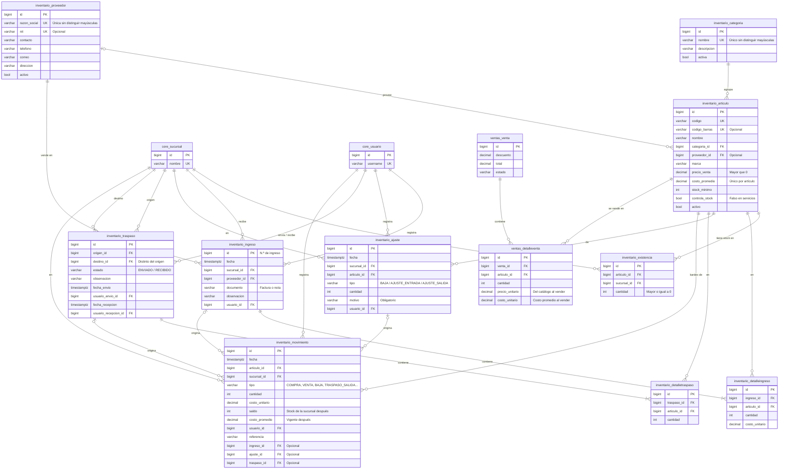

# Módulo de Inventario

Ópticas Casimiro · SIS301 Análisis y Diseño de Sistemas

Este documento acompaña al código fuente del módulo de inventario (app `inventario`). Reúne la guía de demostración, el diagrama entidad-relación, los permisos del módulo, las reglas de negocio y la correspondencia con los requisitos del documento de visión.

**Estado:** están implementados el catálogo, las existencias por sucursal, los ingresos por compra, las bajas y los ajustes, los traspasos, el kardex valorado y la integración con Ventas (la venta descuenta stock y su anulación lo repone). Faltan las alertas de stock mínimo y los reportes de inventario valorado.

## 1. Cómo ejecutar la demostración

```bash
.venv/Scripts/python manage.py migrate
.venv/Scripts/python manage.py preparar_demo
.venv/Scripts/python manage.py runserver
```

`preparar_demo` borra los movimientos de inventario creados en los ensayos y vuelve a cargar el catálogo de prueba con sus movimientos iniciales:

- **Catálogo:** 5 categorías, 2 proveedores y 9 artículos (armazones, lunas, lentes de contacto, accesorios y 2 servicios que no controlan stock).
- **Compras:** 3 ingresos en la Sucursal Centro. ARM-001 se compró dos veces a distinto costo, así que su costo promedio quedó en Bs 157,50: (10 × 150 + 6 × 170) / 16.
- **Traspasos:** uno de Centro a Norte ya recibido por `cajero2` y otro **enviado y pendiente de recepción**.
- **Baja:** un armazón con la bisagra rota.
- **Venta de ejemplo** de `cajero1` (de ayer, con la caja ya cerrada): 1 armazón ARM-001 y 2 lunas LUN-001, con Bs 60 de descuento. Descontó esas unidades del stock de Centro.

Todos los usuarios tienen la contraseña **`Casimiro2026!`**.

| Usuario | Sucursal | Qué demostrar |
|---|---|---|
| `almacen` | Centro | Catálogo, proveedores, ingresos, bajas y ajustes, traspasos y kardex |
| `gerente` | Centro | Consulta artículos, costos y kardex. Anula ventas: necesita abrir su caja para devolver lo pagado |
| `cajero1` | Centro | Vende artículos (descuenta stock). Consulta precios y stock, pero no ve costos ni puede recibir el traspaso enviado a Norte |
| `cajero2` | Norte | Confirma la recepción del traspaso pendiente |

**Recorrido sugerido:**

1. Como `almacen`, abra *Inventario → Artículos y stock* → ARM-001 → **Kardex**. Cada fila muestra la entrada o la salida, el saldo de la sucursal, el costo promedio y el valor.
2. Registre un ingreso (*Inventario → Ingresos por compra → Nuevo ingreso*) de ARM-001 con un costo distinto. Vuelva al kardex: el stock sube y el costo promedio se recalcula.
3. Intente un traspaso de ARM-002 con más unidades de las que hay en Centro. El sistema responde "Stock insuficiente…" y no mueve ninguna línea.
4. Registre una baja o un ajuste por conteo físico desde el detalle de un artículo (*Baja o ajuste*). El motivo es obligatorio.
5. Inicie sesión como `cajero2`. *Inventario → Traspasos* avisa que hay un traspaso por recibir. Ábralo y pulse **Confirmar recepción**: las unidades entran al stock de Norte.
6. Inicie sesión como `cajero1` y abra el mismo traspaso: no aparece el botón para recibirlo, porque no pertenece a la sucursal de destino.
7. Como `cajero1`, abra su caja y registre una venta (*Ventas → Nueva venta*) con un armazón, una luna y el examen visual. El total se calcula en vivo y el examen no descuenta stock. En el kardex del armazón aparece la *Salida por venta*.
8. Intente vender más unidades de las que hay: el sistema responde "Stock insuficiente…" y no registra ni la venta ni el pago.
9. Como `gerente`, abra su caja con un monto inicial, entre a la venta y pulse **Anular**. El stock vuelve a Centro (*Reposición por venta anulada* en el kardex) y lo pagado sale de la caja del gerente como egreso.

## 2. Diagrama entidad-relación



Las tablas `ventas_venta`, `core_sucursal` y `core_usuario` se muestran solo con algunos campos; el detalle está en [`gestion_usuarios.md`](gestion_usuarios.md#2-diagrama-entidad-relación). Para exportar el diagrama como imagen, pegue el bloque en https://mermaid.live.

**Notas de diseño:**

- **Stock por sucursal:** `inventario_existencia` tiene una fila por artículo y sucursal (restricción única) y una restricción `CHECK (cantidad >= 0)`, así que la base de datos rechaza un stock negativo aunque falle la validación de la aplicación.
- **Kardex:** `inventario_movimiento` es el kardex. Cada fila guarda el saldo de la sucursal y el costo promedio después del movimiento, de modo que el kardex se lee sin recalcular nada. Apunta al documento que la originó (ingreso, ajuste o traspaso). Para las ventas y sus anulaciones guarda solo la referencia ("Nota de venta 000012"), sin clave foránea, porque `ventas` depende de `inventario` y no al revés.
- **Costo promedio único:** `inventario_articulo.costo_promedio` es uno por artículo para toda la empresa. Un traspaso mueve unidades pero no cambia el costo.
- **Integridad referencial:** las claves foráneas son `ON DELETE PROTECT`. Un artículo, proveedor o sucursal con movimientos no se puede borrar; se desactiva. El detalle de un ingreso o traspaso es la única relación `CASCADE`, y los documentos no se borran desde el sistema.
- **Servicios:** el examen visual y el montaje son artículos con `controla_stock = false`. Se venden, pero no tienen existencias ni kardex.

## 3. Permisos del módulo

Extracto de la matriz que genera `manage.py matriz_permisos` a partir de `core/roles.py`. La matriz completa está en [`gestion_usuarios.md`](gestion_usuarios.md#3-matriz-de-permisos-por-rol).

| Permiso | Código | Administrador | Gerente | Cajero/Vendedor | Recursos Humanos | Encargado de almacén | Óptico/Técnico de taller | Empleado |
|---|---|:---:|:---:|:---:|:---:|:---:|:---:|:---:|
| Consultar artículos, precios y stock por sucursal | `inventario.ver_articulos` | ✔ | ✔ | ✔ |  | ✔ | ✔ |  |
| Crear y editar artículos y categorías | `inventario.gestionar_catalogo` | ✔ |  |  |  | ✔ |  |  |
| Ver, crear y editar proveedores | `inventario.gestionar_proveedores` | ✔ |  |  |  | ✔ |  |  |
| Registrar ingresos de mercadería por compra | `inventario.registrar_ingresos` | ✔ |  |  |  | ✔ |  |  |
| Registrar bajas y ajustes por conteo físico | `inventario.registrar_ajustes` | ✔ |  |  |  | ✔ |  |  |
| Enviar mercadería a otra sucursal | `inventario.enviar_traspasos` | ✔ |  |  |  | ✔ |  |  |
| Confirmar la recepción de traspasos en su sucursal | `inventario.recibir_traspasos` | ✔ |  | ✔ |  | ✔ |  |  |
| Ver el kardex, los costos y los movimientos de inventario | `inventario.ver_kardex` | ✔ | ✔ |  |  | ✔ |  |  |

- El Cajero/Vendedor puede confirmar la recepción porque en una sucursal pequeña es quien recibe la mercadería. Solo puede recibir los traspasos dirigidos a su propia sucursal.
- El costo promedio solo lo ven quienes tienen `ver_kardex`. El cajero ve el precio de venta y el stock, pero no el costo.

## 4. Reglas de negocio

- **Costo promedio ponderado:** cada compra recalcula el costo del artículo:

  costo nuevo = (unidades actuales × costo actual + unidades compradas × costo de compra) / (unidades actuales + unidades compradas)

  Las unidades actuales son las de todas las sucursales más las que están en tránsito. El resultado se guarda con 4 decimales. Las salidas (bajas, ajustes de salida y traspasos) se valoran al costo promedio vigente.
- **Traspasos en dos pasos:** al enviarlo, la mercadería sale del stock del origen y queda en tránsito, sin estar disponible en ninguna sucursal. Al confirmarlo una persona de la sucursal de destino, entra a su stock. Un traspaso no se recibe dos veces.
- **Ventas:** registrar una venta descuenta del stock de la sucursal del vendedor las unidades de cada artículo, valoradas al costo promedio, que la línea de la venta guarda. Los servicios se venden sin tocar el stock. Si falta stock de una línea, no se registra ni la venta ni el pago.
- **Anulación:** las unidades vuelven al stock al costo con que salieron, así que el costo promedio se recalcula como en una compra. Por ejemplo, si quedan 2 unidades a Bs 150 y vuelven 4 que salieron a Bs 120, el nuevo promedio es (2 × 150 + 4 × 120) / 6 = Bs 130.
- **Bajas y ajustes:** la baja (rotura, pérdida, vencimiento) y el ajuste de salida descuentan stock. El ajuste de entrada lo suma. Los tres exigen un motivo.
- **Consistencia (RNF05):** cada operación se ejecuta en una sola transacción. Bloquea los artículos con `SELECT … FOR UPDATE` en orden de clave para evitar bloqueos mutuos, actualiza la existencia y crea la línea del kardex. Si una línea falla (por ejemplo, por stock insuficiente), no se aplica ninguna.
- **Validaciones:** un documento no puede repetir el mismo artículo ni incluir servicios, y las cantidades deben ser mayores que cero. Un ingreso además rechaza los artículos y proveedores inactivos. Un artículo inactivo sí puede darse de baja o traspasarse, para sacar el stock que le quede.

Toda esta lógica está en `inventario/servicios.py` (`registrar_ingreso`, `registrar_ajuste`, `enviar_traspaso`, `recibir_traspaso`, `registrar_salida_venta` y `reponer_venta`), no en las vistas. `ventas/servicios.py` (`registrar_venta` y `anular_venta`) llama a las dos últimas dentro de su propia transacción, junto con el cobro o la devolución en caja.

## 5. Cumplimiento de los requisitos

| Requisito | Estado | Implementación |
|---|---|---|
| RF08 Artículos y existencias por sucursal | Hecho | Catálogo con código, código de barras, categoría, proveedor, marca, precio, stock mínimo y estado. Stock en `inventario_existencia` |
| RF09 Ingresos por compra | Hecho | *Ingresos por compra*: proveedor, factura y varias líneas con cantidad y costo |
| RF10 Salidas por ventas, bajas o traspasos | Hecho | Ventas con líneas de artículos, bajas, ajustes y traspasos en dos pasos. La anulación de una venta repone el stock |
| RF11 Kardex valorado por costo promedio ponderado | Hecho | Kardex por artículo y sucursal, con saldo, costo promedio y valor |
| RF12 Alertas de stock mínimo | Pendiente | Fase 4 |
| RF13 Gestión de proveedores | Hecho | CRUD de proveedores con baja lógica |
| RF14 Reportes de existencias e inventario valorado | Pendiente | Fase 4 |
| RNF05 Consistencia del stock | Hecho | La venta, el descuento de stock, el kardex y el pago se registran en una sola transacción con bloqueo de filas. Igual en ingresos, ajustes, traspasos y anulaciones |

## 6. Scripts SQL y pruebas

Los scripts de [`sql/`](sql/) incluyen las tablas y los datos de prueba de inventario. Se cargan igual que en la entrega anterior (ver [`gestion_usuarios.md`](gestion_usuarios.md#5-scripts-sql)).

```bash
.venv/Scripts/python manage.py test inventario ventas
```

Los tests de `ventas/tests.py` cubren el descuento de stock y el kardex de la venta, la reversión completa si falta stock, el descuento y las validaciones del total, y la anulación: reposición al costo de la venta, devolución por forma de pago, motivo obligatorio, caja abierta y permisos.

Los tests de `inventario/tests.py` cubren el catálogo y sus validaciones, el cálculo del costo promedio (incluidas las unidades en tránsito), la reversión completa ante stock insuficiente, el traspaso en dos pasos, los ajustes, el rechazo de servicios y artículos inactivos, los formularios con varias líneas y los permisos de cada pantalla.
