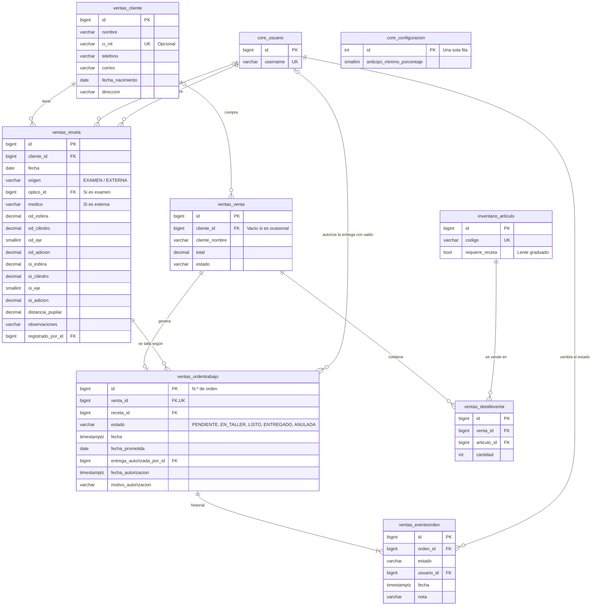

# Clientes, recetas y órdenes de trabajo

Ópticas Casimiro · SIS301 Análisis y Diseño de Sistemas

Este documento acompaña a la parte del módulo de ventas que registra a los clientes y sus recetas, y lleva las órdenes de trabajo del taller propio. Reúne la guía de demostración, el diagrama entidad-relación, los permisos, las reglas de negocio y la correspondencia con los requisitos del documento de visión.

**Estado:** cubre RF05 (clientes), RF21 y RF22 (recetas e historial), RF23 y RF24 (órdenes de trabajo), RF31 (entrega con saldo autorizada por el gerente) y RF32 (anticipo mínimo configurable).

## 1. Cómo ejecutar la demostración

```bash
.venv/Scripts/python manage.py migrate
.venv/Scripts/python manage.py preparar_demo
.venv/Scripts/python manage.py runserver
```

`preparar_demo` carga tres clientes:

- **María Fernanda López Rojas:** tiene dos recetas de examen en la óptica, una de hace un año y otra reciente, para mostrar el historial. Ayer compró un armazón y dos lunas graduadas con un anticipo de Bs 350 sobre Bs 650, así que tiene una **orden de trabajo lista para entregar con saldo pendiente de Bs 300**.
- **Carlos Andrés Vargas Soliz:** tiene una receta externa con adición (presbicia).
- **Rosa Elena Quiroga Mendoza:** no tiene recetas, para registrar una en la demostración.

El anticipo mínimo empieza en 50 %. Todos los usuarios tienen la contraseña **`Casimiro2026!`**.

| Usuario | Qué demostrar |
|---|---|
| `optico` | Registra recetas de examen (figura como responsable) y avanza las órdenes en el taller |
| `cajero1` | Registra clientes y recetas externas, vende lentes graduados, cobra el saldo y entrega el trabajo |
| `gerente` | Autoriza la entrega con saldo y cambia el anticipo mínimo en *Administración → Parámetros* |

**Recorrido sugerido:**

1. Como `optico`, abra *Ventas → Clientes y recetas* → Rosa Quiroga → **Nueva receta**. Registre un examen; pruebe con un eje sin cilindro o una esfera que no sea múltiplo de 0,25 para ver las validaciones.
2. Como `cajero1`, abra su caja y, desde la ficha de Rosa, pulse **Nueva venta**. El cliente y su receta más reciente ya están elegidos. Agregue un armazón y dos LUN-001 (marcadas «con receta»). El formulario avisa el anticipo mínimo; si paga menos, la venta se rechaza.
3. Al registrar la venta se genera la orden de trabajo. Como `optico`, en *Ventas → Órdenes de trabajo*, ábrala y pulse **Pasar al taller** y luego **Marcar como listo**.
4. Abra la orden de María (ya lista, con saldo). Como `cajero1`, el botón **Entregar al cliente** está desactivado. Como `gerente`, escriba un motivo y pulse **Autorizar**. Vuelva como `cajero1` y entregue: el historial registra quién autorizó y quién entregó.
5. Otra forma de entregar: cobre el saldo desde la misma orden (*Cobrar el saldo*) y la entrega queda habilitada sin autorización.
6. Como `gerente`, cambie el anticipo a 30 % en *Administración → Parámetros* y repita el paso 2 con un anticipo menor.

## 2. Diagrama entidad-relación



`ventas_venta`, `ventas_detalleventa`, `inventario_articulo` y `core_usuario` se muestran solo con los campos que intervienen aquí; el detalle está en [`gestion_usuarios.md`](gestion_usuarios.md#2-diagrama-entidad-relación) y [`inventario.md`](inventario.md#2-diagrama-entidad-relación). `core_configuracion` no tiene relaciones: guarda los parámetros del negocio en una sola fila.

**Notas de diseño:**

- **Cliente en la venta:** `ventas_venta.cliente_id` es opcional, para las ventas a clientes ocasionales. La venta guarda además el nombre y el CI del cliente al momento de vender, que imprime la nota.
- **Receta inmutable:** una receta no se edita. Una graduación nueva es una fila nueva, y el historial del cliente es la lista de sus recetas ordenada por fecha.
- **Una orden por venta:** `ventas_ordentrabajo.venta_id` es único. La orden apunta a la receta con la que se talla.
- **Historial de la orden:** cada cambio de estado, la autorización de entrega con saldo y la anulación crean una fila en `ventas_eventoorden` con el usuario, la fecha y una nota.
- **Integridad referencial:** las claves foráneas son `ON DELETE PROTECT`, salvo el historial de la orden (`CASCADE`). Un cliente con recetas o ventas, o una receta usada en una orden, no se pueden borrar.

## 3. Permisos

Extracto de la matriz que genera `manage.py matriz_permisos`. La matriz completa está en [`gestion_usuarios.md`](gestion_usuarios.md#3-matriz-de-permisos-por-rol).

| Módulo | Permiso | Código | Administrador | Gerente | Cajero/Vendedor | Recursos Humanos | Encargado de almacén | Óptico/Técnico de taller | Empleado |
|---|---|---|:---:|:---:|:---:|:---:|:---:|:---:|:---:|
| Parámetros | Definir los parámetros del negocio (anticipo mínimo) | `core.change_configuracion` | ✔ | ✔ |  |  |  |  |  |
| Clientes y recetas | Registrar y editar clientes | `ventas.gestionar_clientes` | ✔ |  | ✔ |  |  | ✔ |  |
| Clientes y recetas | Registrar recetas de los clientes | `ventas.registrar_receta` | ✔ |  | ✔ |  |  | ✔ |  |
| Clientes y recetas | Realizar exámenes visuales (figurar como óptico responsable) | `ventas.realizar_examen` | ✔ |  |  |  |  | ✔ |  |
| Órdenes de trabajo | Consultar las órdenes de trabajo | `ventas.ver_ordenes` | ✔ | ✔ | ✔ |  |  | ✔ |  |
| Órdenes de trabajo | Pasar las órdenes al taller y marcarlas como listas | `ventas.actualizar_ordenes` | ✔ |  |  |  |  | ✔ |  |
| Órdenes de trabajo | Entregar los trabajos al cliente | `ventas.entregar_ordenes` | ✔ |  | ✔ |  |  | ✔ |  |
| Órdenes de trabajo | Autorizar la entrega de un trabajo con saldo pendiente | `ventas.autorizar_entrega_con_saldo` | ✔ | ✔ |  |  |  |  |  |

- El gerente consulta los clientes y recetas a través de `ventas.ver_todas_ventas`; quien tiene `ver_ordenes` también los consulta, para ver la receta de cada trabajo.
- El Óptico/Técnico de taller ve el menú *Ventas* solo con las órdenes de trabajo y los clientes: no registra ventas ni cobra.

## 4. Reglas de negocio

- **Validación de la receta:** esfera entre −25 y +25, cilindro entre −10 y +10 y adición entre +0,25 y +4, siempre en pasos de 0,25. Si hay cilindro, el eje es obligatorio (de 1 a 180°); sin cilindro, el eje queda vacío. La distancia pupilar va de 40 a 80 mm. La fecha no puede ser futura.
- **Origen de la receta:** una receta de examen exige un óptico responsable con `realizar_examen` y no lleva médico; una externa exige el médico o la institución y no lleva óptico.
- **Venta de lentes graduados:** si una línea es un artículo con `requiere_receta`, la venta exige un cliente registrado, una receta de ese mismo cliente y un anticipo de al menos el porcentaje configurado del total, redondeado al centavo hacia arriba. En la misma transacción que la venta, el stock y el pago, se crea la orden de trabajo en estado pendiente.
- **Flujo de la orden:** el taller la avanza un paso a la vez: pendiente → en taller → listo. La entrega solo se hace con la orden lista.
- **Entrega con saldo (RF31):** si la venta tiene saldo, la entrega se rechaza salvo que el gerente la haya autorizado con un motivo. La autorización guarda quién la dio, cuándo y por qué, y el historial indica con qué saldo se entregó. Si el saldo se cobra, la entrega no necesita autorización. El saldo puede cobrarse desde la propia orden, aunque quien cobra no sea el vendedor.
- **Anulación:** anular la venta anula la orden y lo deja en el historial con el motivo. Una venta cuyo trabajo ya se entregó no se puede anular.

La lógica está en `ventas/servicios.py`: `registrar_venta`, `avanzar_orden`, `autorizar_entrega`, `entregar_orden` y `anular_venta`. La validación de la receta está en el modelo (`Receta.clean()`), que el formulario aplica antes de guardar.

## 5. Cumplimiento de los requisitos

| Requisito | Implementación |
|---|---|
| RF05 Datos básicos del cliente | *Clientes y recetas*: registro, edición, búsqueda por nombre, CI/NIT o teléfono, y ficha con recetas, compras y órdenes |
| RF21 Receta oftalmológica | OD/OI con esfera, cilindro, eje y adición, distancia pupilar, fecha y origen (examen con óptico responsable o receta externa con médico o institución) |
| RF22 Historial de recetas | La ficha del cliente lista todas sus recetas, de la más reciente a la más antigua |
| RF23 Orden de trabajo al vender lentes graduados | Se genera con la venta, asociada a la receta elegida, con la fecha de entrega prometida |
| RF24 Estados de la orden y consulta por estado | Pendiente, en taller, listo, entregado (y anulada). Lista filtrable por estado y sucursal, con el conteo de cada estado e indicador en el inicio |
| RF31 Entrega con saldo solo con autorización | La entrega se bloquea con saldo; el gerente la autoriza con un motivo, que queda registrado |
| RF32 Anticipo mínimo configurable | Porcentaje en *Administración → Parámetros* (50 % al iniciar), exigido al registrar la venta |

## 6. Pruebas

```bash
.venv/Scripts/python manage.py test ventas
```

`ventas/tests_ordenes.py` cubre las validaciones de la receta y de su origen, el CRUD de clientes con CI/NIT único, la venta de lentes graduados (orden generada, cliente y receta propia obligatorios, anticipo mínimo y su cambio de porcentaje), el flujo del taller, la entrega con saldo con y sin autorización, el cobro del saldo desde la orden, la anulación de la orden con la venta, el bloqueo de anular un trabajo entregado y los permisos de cada pantalla.
